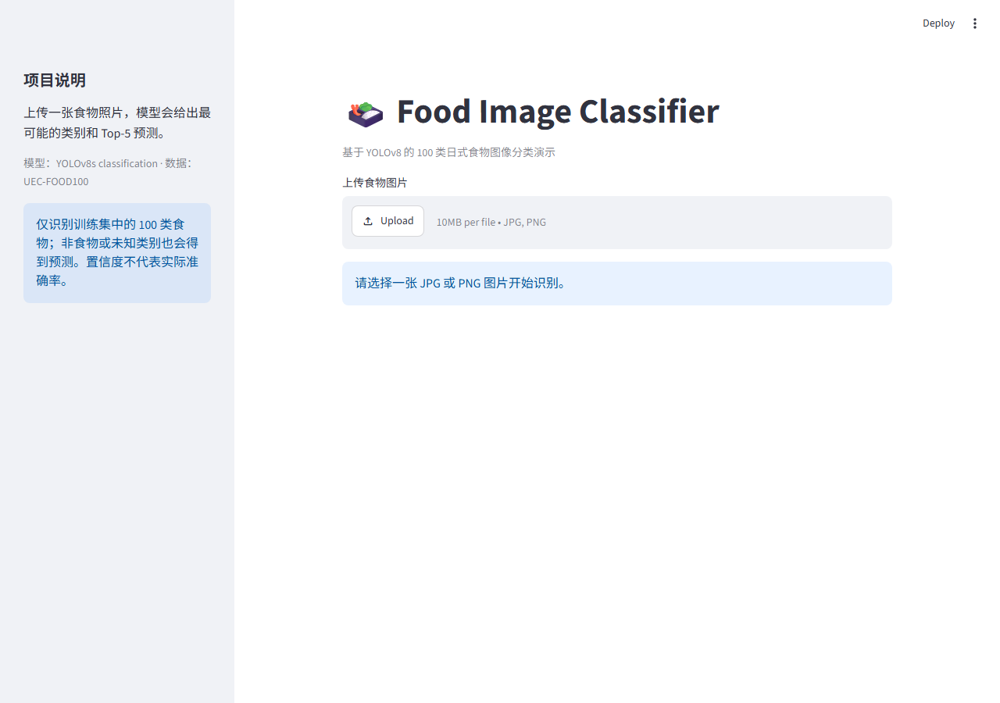

# Food Image Classifier 🍱

A bilingual **Streamlit** demo using a graduation-project **YOLOv8s classification model** trained for **UEC-FOOD100**.

上传食物图片，查看中文及英文类别、Top-5 预测和置信度。项目保留毕业设计中的模型，并整理为可在本地运行的演示。



## Features

- JPG / JPEG / PNG upload, orientation correction and a 10 MB limit.
- 100 food categories with Chinese translations and English labels.
- CPU inference; no dedicated GPU required.
- Cached model and in-memory uploaded images, without application-level image saving.
- Model documentation, historical experiment evidence and an evaluation command.

The original graduation project included classification experiments and a Streamlit application. This repository packages its trained model and a simplified interface. YOLO architecture and inference come from Ultralytics; no new model architecture is claimed. The historical archive also contains ResNet50 work, but this application serves only the YOLO classifier.

## Run locally

Use **Python 3.11**. Download using **Code → Download ZIP**, extract it, and open a terminal inside the project folder.

### Windows PowerShell

```powershell
python -m venv .venv
.\.venv\Scripts\python.exe -m pip install -r requirements.txt
.\.venv\Scripts\python.exe -m streamlit run app.py
```

No activation-policy change is needed.

### macOS / Linux

```bash
python3.11 -m venv .venv
.venv/bin/python -m pip install -r requirements.txt
.venv/bin/python -m streamlit run app.py
```

Open the local address printed by Streamlit (normally `http://localhost:8501`). Upload a food photo and click **开始分类**. Initial dependency installation requires internet; the model is included. Only Windows / Python 3.11 is verified for this release. Other platforms may need platform-specific PyTorch installation.

## Repository contents

| Path | Purpose |
| --- | --- |
| `app.py`, `labels.py` | UI, prediction and bilingual labels |
| `models/food100.pt` | Original trained checkpoint |
| `requirements.txt` | Pinned core runtime |
| `requirements-lock-windows.txt` | Full verified Windows environment |
| `scripts/evaluate.py` | Optional local dataset evaluation |
| `experiments/` | Archived configuration and metrics |
| `docs/` | Model card and verification record |
| `UPLOAD_GUIDE.md` | GitHub upload instructions in Chinese |

## Model and experiments

Read the [model card](docs/MODEL_CARD.md), [historical experiment notes](experiments/README.md) and [verification record](docs/VERIFICATION.md).

The historical configuration and CSV have inconsistent epoch counts. Metrics are preserved as evidence, **not advertised as verified test performance** of this checkpoint. A few successful predictions do not establish dataset-wide accuracy.

Evaluate a separately obtained, authorized copy of the prepared dataset:

```powershell
.\.venv\Scripts\python.exe scripts/evaluate.py --data "D:\datasets\UECFOOD100_div" --split test
```

On macOS / Linux use `.venv/bin/python` and your dataset path. The root must contain `train/`, `val/` and `test/`, each with class-named image folders. All 100 class names must match the model's English labels. Evaluation uses CPU, input size 128 and batch size 32; outputs go to ignored `runs/`. Dataset images are not included.

## Inference examples

Actual local smoke-check outputs (three test images, not an accuracy benchmark):

| Expected class | Predicted class | Model score |
| --- | --- | --- |
| rice | pork miso soup | 28.95% |
| sushi | sushi | 94.30% |
| pizza | pizza | 100.00% |

The rice example is incorrect. Full Top-5 outputs are recorded in [prediction_examples.json](docs/prediction_examples.json); dataset images are not redistributed.

## Limitations

- Closed-set classification: even non-food and unknown foods receive one of 100 labels.
- No multi-food localization, unknown-class rejection, calorie or allergy assessment.
- Confidence is a model score, not a guarantee of correctness.
- Lighting, framing, cuisine and preprocessing can affect results.
- Original weights were created with an older runtime. Modern inference is verified separately; identical historical preprocessing is not claimed.
- Original data splitting and potential overlap have not been independently audited.

## Attribution and license

Application source: **AGPL-3.0**. See [LICENSE](LICENSE) and [third-party notices](THIRD_PARTY_NOTICES.md).

- [UEC-FOOD100 dataset publisher](https://foodcam.mobi/dataset100.html)
- [Ultralytics YOLO](https://github.com/ultralytics/ultralytics)
- [Streamlit](https://streamlit.io/)

The model is included for the graduation-project demo. Dataset images, personal academic documents, login credentials and training archives are excluded. Dataset and dependency rights remain with their owners; unrestricted commercial rights to the dataset or weights are not asserted.
