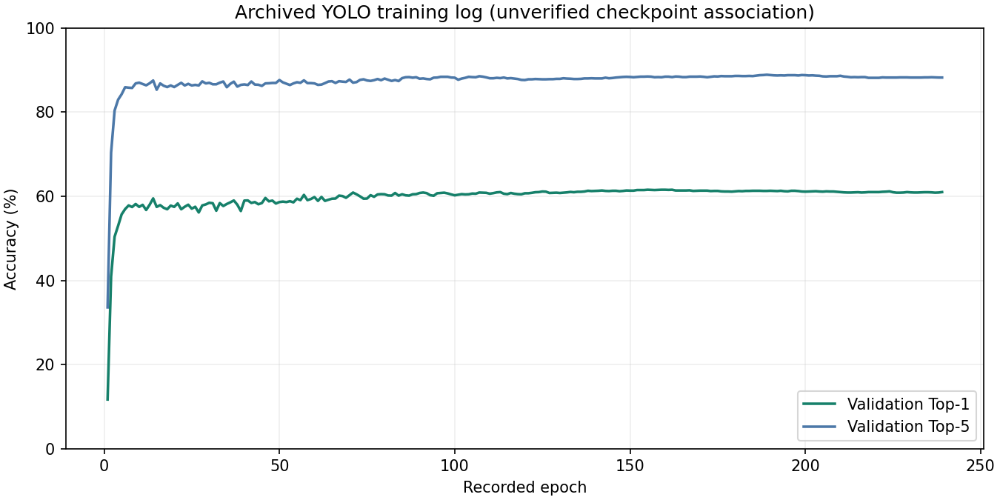

# Historical experiment evidence

Recovered from the original graduation-project experiment archive:

- `archived_yolo_args.yaml`: YOLOv8s classification, input 128, batch 64, seed 0, epochs 200.
- `archived_yolo_results.csv`: 239 recorded epochs ending at 239. Highest validation Top-1: 61.56% at epoch 155; same-row Top-5: 88.46%.

The configuration and CSV have inconsistent epoch counts. These are historical records, NOT independently verified performance of the included checkpoint. ResNet50 configuration and several logs also exist in the source archive, but no controlled comparison is claimed here.

The local prepared dataset has 8,579 train images, 2,869 validation images and 2,913 test images, with 100 class folders per split. These are local counts, not publisher dataset-size claims. Original split generation and overlap checks have not been verified.

This configuration is reference material, not a modern training recipe. Use `scripts/evaluate.py` for a fresh evaluation on a separately obtained dataset. Validation metrics must not be reported as test accuracy.

